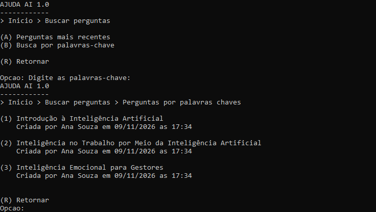
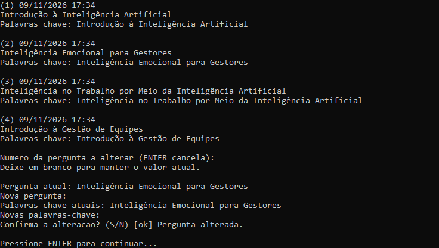
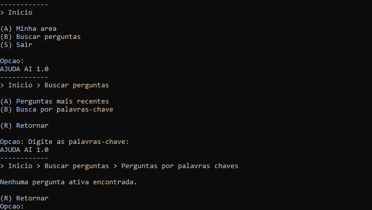
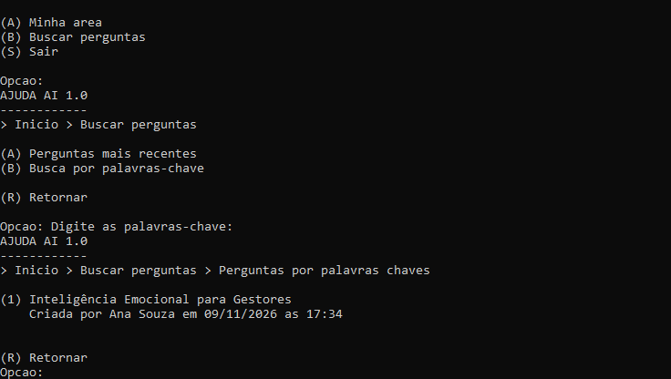

<div align="center">

# Ajuda Aí 1.0

### Trabalho Prático 3 — Índice invertido

**Algoritmos e Estruturas de Dados III** · Ciência da Computação · PUC Minas — Coração Eucarístico  

Prof. Marcos André S. Kutova · 2º semestre de 2026

**Vídeo de demonstração:** _link a adicionar_

</div>

## Participantes

| Nome |
|------|
| Arthur Mendes Lima |
| Gabriel Teodoro Gomes |
| Jean Carlos Lopes Lellis |
| Nicolas Alexandre Torres Dias |

## Sumário

1. [Descrição do sistema](#1-descrição-do-sistema)
2. [Como compilar e executar](#2-como-compilar-e-executar)
3. [Arquitetura](#3-arquitetura)
4. [Telas do sistema](#4-telas-do-sistema)
5. [Classes criadas e atualizadas](#5-classes-criadas-e-atualizadas)
6. [Operações especiais](#6-operações-especiais)
7. [Limitações conhecidas](#7-limitações-conhecidas)
8. [Checklist oficial](#8-checklist-oficial)

## 1. Descrição do sistema

O **Ajuda Aí 1.0** é um sistema de perguntas e respostas executado em terminal. Os dados ficam em **arquivos binários**, sem gerenciador de banco de dados externo.

O usuário pode se cadastrar, entrar no sistema, recuperar a senha pela pergunta secreta, gerenciar seus dados e incluir, alterar, listar e arquivar suas perguntas. As perguntas ativas podem ser listadas da mais recente para a mais antiga ou buscadas por palavras-chave.

Nesta terceira etapa, o sistema ganhou um **índice invertido** sobre o atributo `palavrasChave` das perguntas, construído com a classe `ListaInvertida` fornecida pelo professor. A busca devolve as perguntas ordenadas pelo valor **TF×IDF**.

### Principais recursos do TP3

| Recurso | Descrição |
|---|---|
| **Índice invertido** | Cada termo aponta para a lista de pares `(idPergunta; TF)` das perguntas em que aparece. |
| **Tratamento de termos** | As palavras-chave são convertidas para minúsculas, perdem os acentos e passam por um filtro de stop words. |
| **Busca por palavras-chave** | Nova opção em *Início > Buscar perguntas*, aceitando um ou mais termos. |
| **Ranking TF×IDF** | As pontuações dos termos são somadas por pergunta, e o resultado é apresentado em ordem decrescente, de 5 em 5. |
| **Índice sempre atualizado** | Inclusão, alteração, arquivamento e exclusão de perguntas atualizam as listas e o total de entidades. |

## 2. Como compilar e executar

O projeto utiliza exclusivamente a biblioteca padrão do Java. A partir da raiz do repositório:

**Git Bash, Linux ou macOS**

```bash
cd TP3
javac -encoding UTF-8 -d bin $(find src -name "*.java")
java -cp bin -Dstdout.encoding=UTF-8 Principal
```

**PowerShell**

```powershell
cd TP3
javac -encoding UTF-8 -d bin (Get-ChildItem -Recurse -Filter *.java src | ForEach-Object { $_.FullName })
java -cp bin "-Dstdout.encoding=UTF-8" Principal
```

**Prompt de comando (CMD)**

```cmd
cd TP3
dir /s /b src\*.java > sources.txt
javac -encoding UTF-8 -d bin @sources.txt
java -cp bin -Dstdout.encoding=UTF-8 Principal
```

> **Nota:** Os arquivos de dados e índices são criados automaticamente em `TP3/dados/` na primeira execução. Para reiniciar a base, basta apagar essa pasta. No console do Windows, execute `chcp 65001` antes do programa para que os acentos sejam exibidos corretamente.

## 3. Arquitetura

O sistema segue a organização em três camadas:

* **Visão (`view`)**: interação no terminal, apenas exibindo informações e lendo comandos.
* **Controle (`repository`)**: regras de negócio e validações.
* **Persistência (`files`)**: extensões do CRUD genérico que mantêm os índices sincronizados.

```
TP3/src/
├── Principal.java                          Abre os arquivos e conecta as dependências
├── view/                                   Camada de apresentação textual
│   ├── Console.java
│   ├── MenuAcesso.java
│   ├── MenuPrincipal.java
│   ├── MenuMinhaArea.java
│   ├── MenuMeusDados.java
│   ├── MenuPerguntas.java
│   ├── MenuBuscarPerguntas.java            (atualizado) Inclui a busca por palavras-chave
│   ├── MenuPerguntasMaisRecentes.java
│   └── MenuPerguntasPorPalavrasChaves.java (novo) Consulta e resultados paginados
├── repository/                             Camada de regras de negócio
│   ├── CrudUsuario.java
│   └── CrudPergunta.java                   (atualizado) Expõe a busca por palavras-chave
├── files/                                  Camada de arquivos e índices
│   ├── ArquivoUsuario.java
│   └── ArquivoPergunta.java                (atualizado) Mantém o índice invertido e calcula o TF×IDF
├── entities/                               Classes de dados serializáveis
│   ├── Usuario.java
│   ├── Pergunta.java
│   └── Resposta.java
├── aed3/                                   Estruturas de dados da disciplina
│   ├── Arquivo.java
│   ├── ArvoreBMais.java
│   ├── HashExtensivel.java
│   ├── ListaInvertida.java                 (novo) Listas invertidas fornecidas pelo professor
│   ├── ElementoLista.java                  (novo) Par (id; frequência) das listas
│   └── ...
└── util/
    ├── Crypto.java
    └── PalavrasChave.java                  (novo) Normalização e filtro de stop words
```

### Índices utilizados

| Estrutura | Par chave-valor | Finalidade |
|---|---|---|
| Hash Extensível | `id → endereço` | Índice direto de cada entidade, embutido na classe `Arquivo`. |
| Hash Extensível | `email → idUsuario` | Autenticação e verificação de e-mail duplicado. |
| Árvore B+ | `(idUsuario, idPergunta)` | Perguntas de um usuário. |
| Árvore B+ | `(criacao, idPergunta)` | Listagem das perguntas mais recentes. |
| Lista Invertida | `termo → (idPergunta; TF)` | **(Novo)** Busca de perguntas por palavras-chave. |

O índice invertido é gravado em dois arquivos: `dados/perguntas/dicionarioPalavras.listainv.db` guarda o total de entidades e os termos, e `dados/perguntas/blocosPalavras.listainv.db` guarda os blocos encadeados com 5 elementos cada.

## 4. Telas do sistema

As capturas abaixo foram feitas no console do Windows, usando as frases do exemplo do enunciado como perguntas e como palavras-chave. Nos testes, a entrada foi enviada ao programa por redirecionamento, por isso o texto digitado não aparece após os prompts. A legenda de cada imagem informa o que foi digitado.

### Busca por mais de uma palavra-chave, ordenada por TF×IDF

Termos digitados: `Inteligência Artificial`.



### Busca antes e depois da alteração das palavras-chave

Antes da alteração, a pergunta é encontrada pelo termo `emocional`.


Em *Minha área > Minhas perguntas > Alterar*, as palavras-chave da pergunta 2 foram trocadas por `culinaria;receitas`.



Depois da alteração, o termo antigo `emocional` não encontra mais a pergunta.



O novo termo `culinária` encontra a pergunta. A acentuação da consulta é ignorada, pois os termos passam pelo mesmo tratamento da indexação.



## 5. Classes criadas e atualizadas

| Classe | Camada | Responsabilidade |
|---|---|---|
| `aed3.ListaInvertida` | AED3 | Classe fornecida pelo professor. Mantém o dicionário de termos, os blocos encadeados e o total de entidades. |
| `aed3.ElementoLista` | AED3 | Classe fornecida pelo professor. Representa o par `(id; frequência)`. |
| `util.PalavrasChave` | Utilitário | **Nova.** Transforma um texto no vetor de termos válidos, tanto na indexação quanto na consulta. |
| `view.MenuPerguntasPorPalavrasChaves` | Visão | **Nova.** Lê a consulta e exibe os resultados de 5 em 5, com opções de página anterior e próxima página. |
| `files.ArquivoPergunta` | Arquivos | **Atualizada.** Contém o índice invertido, os métodos privados `indexar()` e `removerDoIndice()` e o método `readByKeywords()`, que calcula o TF×IDF. |
| `repository.CrudPergunta` | Controle | **Atualizada.** Método `listarPorPalavrasChave()`, usado pela visão. |
| `view.MenuBuscarPerguntas` | Visão | **Atualizada.** Opção *(B) Busca por palavras-chave*. |

## 6. Operações especiais

### 1. Tratamento dos termos

`PalavrasChave.tokens()` aplica o mesmo tratamento às palavras-chave cadastradas e aos termos digitados na busca:

1. Remove os acentos com `Normalizer` na forma NFD e passa o texto para minúsculas.
2. Troca por espaço tudo o que não for letra ou dígito, de modo que `;`, vírgula e espaço funcionam como separadores.
3. Descarta as stop words: artigos, preposições, contrações, pronomes e conjunções comuns, numerais por extenso e termos próprios do domínio de perguntas e respostas, como `como`, `qual`, `pergunta` e `duvida`.
4. Descarta os numerais escritos em dígitos, como `2026`.

Por exemplo, `Introdução à Inteligência Artificial` vira `[introducao, inteligencia, artificial]`.

Uma pergunta precisa ter ao menos um termo válido. Palavras-chave como `de;para` ou `2026;10` são recusadas na inclusão e na alteração, antes de qualquer gravação, e a pergunta permanece como estava.

### 2. Construção das listas (TF)

Na inclusão, `ArquivoPergunta.indexar()` percorre o vetor de termos, e cada ocorrência vale `1 / total de termos válidos`. Como a classe `ListaInvertida` não aceita o mesmo ID duas vezes em um termo, o método segue o procedimento do enunciado:

```java
ElementoLista atual = indicePalavras.read(termo, pergunta.getId());
if (atual == null) {
    indicePalavras.create(termo, new ElementoLista(pergunta.getId(), frequencia));
} else {
    indicePalavras.update(termo,
            new ElementoLista(pergunta.getId(), atual.getFrequencia() + frequencia));
}
```

Ao final, a pergunta indexada chama `incrementaEntidades()`, pois o total de entidades é necessário para o IDF.

Com as perguntas do exemplo do enunciado, `inteligencia` tem TF 0,2 + 0,2 = 0,4 na pergunta 3.

### 3. Busca e ranking TF×IDF

`ArquivoPergunta.readByKeywords()` executa os passos do enunciado:

1. Aplica `PalavrasChave.tokens()` à consulta.
2. Lê a lista de cada termo e calcula `IDF = log10(total de entidades / tamanho da lista)`.
3. Multiplica o TF de cada elemento pelo IDF do termo e soma os valores do mesmo ID em um `HashMap`.
4. Ordena os resultados pela pontuação decrescente. Em caso de empate, a pergunta de menor ID vem primeiro.

Consulta `Inteligência Artificial` com as 4 perguntas do enunciado:

| Pergunta | `inteligencia` (TF × 0,125) | `artificial` (TF × 0,301) | Total |
|---|---|---|---|
| 1 | 0,333 × 0,125 = 0,042 | 0,333 × 0,301 = 0,100 | **0,142** |
| 3 | 0,400 × 0,125 = 0,050 | 0,200 × 0,301 = 0,060 | **0,110** |
| 2 | 0,333 × 0,125 = 0,042 | — | **0,042** |

A ordem final é 1, 3, 2, a mesma apresentada na tela da seção 4 e no enunciado. A pergunta 4 não aparece porque não contém nenhum dos termos.

### 4. Manutenção do índice

| Operação | O que acontece no índice invertido |
|---|---|
| **Inclusão** | Os termos são inseridos e o total de entidades aumenta em 1. |
| **Alteração** | Os pares dos termos antigos são removidos e os novos são inseridos, com o total de entidades decrementado e incrementado. |
| **Arquivamento** | Os pares são removidos e o total diminui, para que uma pergunta invisível não influencie o IDF. A pergunta continua nos demais índices e em *Minhas perguntas*. |
| **Exclusão** | Os pares de uma pergunta ativa são removidos junto com os demais índices. Isso também ocorre na exclusão em cascata de um usuário. |

## 7. Limitações conhecidas

* **Respostas e avaliações.** A pasta `TP3` foi construída sobre a base de perguntas e não inclui as telas e regras de respostas e avaliações, que estão na pasta `TP2`. Ao abrir uma pergunta, o sistema exibe um aviso no lugar das respostas.

## 8. Checklist oficial

> **O índice invertido com palavras-chave foi criado usando a classe ListaInvertida?**

**Sim.** `ArquivoPergunta` instancia `aed3.ListaInvertida` com os arquivos `dicionarioPalavras.listainv.db` e `blocosPalavras.listainv.db` e a mantém na inclusão, alteração, arquivamento e exclusão de perguntas.

> **É possível buscar perguntas por palavras-chave no menu de buscar perguntas?**

**Sim.** A opção está em *Início > Buscar perguntas > (B) Busca por palavras-chave*, e aceita um ou mais termos.

> **As perguntas retornadas estão corretamente classificadas pelo modelo TFxIDF?**

**Sim.** `ArquivoPergunta.readByKeywords()` calcula `TF × log10(N / tamanho da lista)`, soma os valores por pergunta e ordena de forma decrescente. O exemplo do enunciado foi reproduzido no sistema e gerou a ordem 1, 3, 2, conforme a seção 6.

> **O trabalho compila corretamente?**

**Sim.** Compilado com `javac -encoding UTF-8` no Java 25, sem erros.

> **O trabalho está completo e funcionando sem erros de execução?**

**Sim.** Tudo o que o enunciado do TP3 pede está implementado. Inclusão, busca com um e vários termos, alteração de palavras-chave, recusa de palavras-chave inválidas, arquivamento, listas com mais de um bloco e reabertura dos arquivos foram testados sem erros de execução. O escopo da pasta `TP3` está descrito na seção 7.

> **O trabalho é original e não a cópia de um trabalho de outro grupo?**

**Sim.** Desenvolvido pelos integrantes do grupo, usando as classes fornecidas pelo professor na disciplina.
