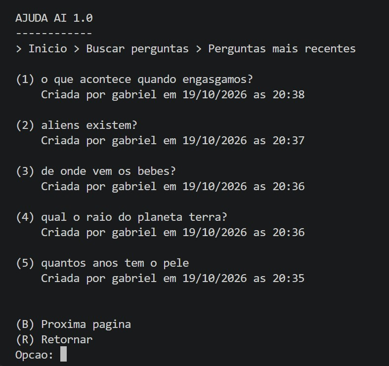
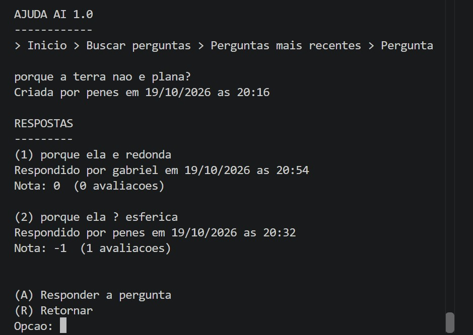
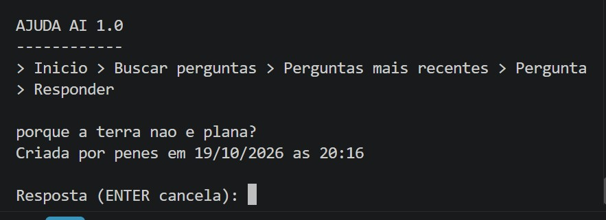
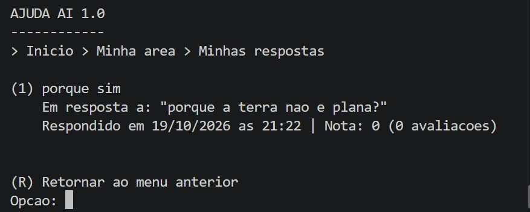
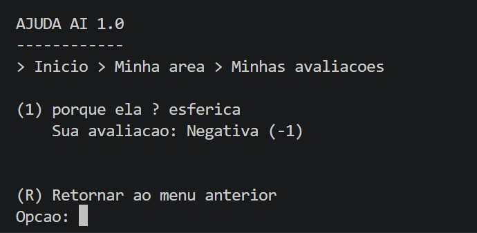

<div align="center">

# Ajuda Aí 1.0

### Trabalho Prático 2 — Relacionamento N:N

**Algoritmos e Estruturas de Dados III** · Ciência da Computação · PUC Minas — Coração Eucarístico  

Prof. Marcos André S. Kutova · 2º semestre de 2026

[**▶ Assistir ao vídeo de demonstração**](https://youtu.be/-6l6Q4uxQ4A)

</div>

## Participantes

| Nome |
|------|
| Arthur Mendes Lima |
| Gabriel Teodoro Gomes |
| Jean Carlos Lopes Lellis |
| Nicolas Alexandre Torres Dias |

## Sumário

1. [Descrição do sistema](#1-descrição-do-sistema)
2. [Como compilar e executar](#2-como-compilar-e-executar)
3. [Arquitetura](#3-arquitetura)
4. [Telas do sistema](#4-telas-do-sistema)
5. [Classes criadas e atualizadas](#5-classes-criadas-e-atualizadas)
6. [Operações especiais](#6-operações-especiais)
7. [Checklist oficial](#7-checklist-oficial)

## 1. Descrição do sistema

O **Ajuda Aí 1.0** é um sistema de fórum de perguntas e respostas executado em terminal que gerencia dados persistidos diretamente em **arquivos binários**, sem qualquer gerenciador de banco de dados externo.

Nesta segunda etapa (TP2), o sistema evoluiu para suportar relacionamentos **N:N** (Muitos para Muitos) entre **Usuários** e **Perguntas** através da entidade intermediária **Resposta**, e entre **Usuários** e **Respostas** por meio da entidade associativa **Avaliação**. Todas as entidades são manipuladas por meio do CRUD genérico implementado sobre arquivos binários com organização em índices diretos (Hash Extensível) e indiretos (Árvores B+).

### Principais recursos do TP2

| Recurso | Descrição |
|---|---|
| **Busca de Perguntas Mais Recentes** | Listagem paginada (de 5 em 5) ordenada de forma decrescente pela data de criação, indexada diretamente por Árvore B+. |
| **Publicação de Respostas** | Qualquer usuário autenticado pode responder a perguntas ativas no sistema. |
| **Ordenação de Respostas** | As respostas de uma pergunta são apresentadas ordenadas decrescentemente por nota de avaliação. |
| **Avaliação de Respostas** | Votos positivos (+1) ou negativos (-1) com bloqueio estrito contra voto duplicado e voto na própria resposta. |
| **Gestão e Moderação de Respostas** | O autor de uma resposta pode arquivá-la; adicionalmente, o autor da pergunta pode moderar e arquivar respostas inadequadas recebidas em suas postagens. |
| **Minhas Respostas e Minhas Avaliações** | Gestão completa pelo autor na área do usuário, permitindo inclusive o cancelamento de uma avaliação com recálculo automático da pontuação da resposta. |

## 2. Como compilar e executar

O projeto utiliza exclusivamente a biblioteca padrão do Java. A partir da pasta raiz `TP2`:

**Git Bash, Linux ou macOS**

```bash
cd TP2
javac -encoding UTF-8 -d bin $(find src -name "*.java")
java -cp bin -Dstdout.encoding=UTF-8 Principal
```

**PowerShell**

```powershell
cd TP2
javac -encoding UTF-8 -d bin (Get-ChildItem -Recurse -Filter *.java src | ForEach-Object { $_.FullName })
java -cp bin "-Dstdout.encoding=UTF-8" Principal
```

**Prompt de comando (CMD)**

```cmd
cd TP2
dir /s /b src\*.java > sources.txt
javac -encoding UTF-8 -d bin @sources.txt
java -cp bin -Dstdout.encoding=UTF-8 Principal
```

> **Nota:** Os arquivos de dados binários e índices são criados automaticamente no diretório `TP2/dados/` durante a primeira execução. Para reiniciar a base de dados ao estado limpo, basta apagar essa pasta.

## 3. Arquitetura

O sistema segue a organização estrita em três camadas:

* **Visão (`view`)**: Gerencia a interação no terminal (apenas exibe informações e lê comandos).
* **Controle (`repository`)**: Implementa as regras de negócio, validações e integridade.
* **Persistência (`files`)**: Estende o CRUD genérico em arquivo binário e sincroniza os índices diretos e secundários.

```
TP2/src/
├── Principal.java                     Instancia arquivos, conecta dependências e inicia o fluxo
├── view/                              Camada de apresentação textual
│   ├── Console.java
│   ├── MenuAcesso.java
│   ├── MenuPrincipal.java
│   ├── MenuMinhaArea.java
│   ├── MenuMeusDados.java
│   ├── MenuPerguntas.java
│   ├── MenuBuscarPerguntas.java       (novo) Menu de opções de busca
│   ├── MenuPerguntasMaisRecentes.java (novo) Listagem paginada por data decrescente
│   ├── MenuResposta.java              (novo) Visualização, resposta, avaliação e moderação
│   ├── MenuMinhasRespostas.java       (novo) Gestão das respostas do usuário logado
│   └── MenuMinhasAvaliacoes.java      (novo) Gestão e cancelamento de votos realizados
├── repository/                        Camada de regras de negócio
│   ├── CrudUsuario.java
│   ├── CrudPergunta.java
│   ├── CrudResposta.java              (novo) Regras de publicação, ordenação e moderação
│   └── CrudAvaliacao.java             (novo) Regras de voto único, cancelamento e pontuação
├── files/                             Camada de arquivos e índices
│   ├── ArquivoUsuario.java            Cascata completa cobrindo respostas e votos
│   ├── ArquivoPergunta.java           Árvore B+ por data de criação
│   ├── ArquivoResposta.java           (novo) CRUD de respostas com duas árvores B+ relacionais
│   └── ArquivoAvaliacao.java          (novo) CRUD de avaliações com árvores para usuário e resposta
├── entities/                          Classes de dados serializáveis
│   ├── Usuario.java
│   ├── Pergunta.java
│   ├── Resposta.java                  (novo) Entidade de Resposta
│   └── Avaliacao.java                 (novo) Entidade de Avaliação
├── aed3/                              Estruturas de dados fundamentais
│   ├── Arquivo.java                   CRUD genérico com índice Hash Extensível por ID
│   ├── ArvoreBMais.java
│   ├── HashExtensivel.java
│   ├── ParIdId.java
│   ├── ParDataId.java                 (novo) Par (data long, idPergunta) para índice temporal
│   └── ...
└── util/
    └── Crypto.java                    Hash SHA-256 e normalização textual
```

### Índices utilizados

| Estrutura | Par chave-valor | Finalidade |
|---|---|---|
| Hash Extensível | `idEntidade → endereço` | Índice direto de cada entidade, embutido no CRUD genérico da classe `Arquivo`. |
| Hash Extensível | `email → idUsuario` | Índice indireto exclusivo para autenticação e verificação de duplicidade de e-mail. |
| Árvore B+ | `(idUsuario, idPergunta)` | Perguntas criadas por um usuário específico. |
| Árvore B+ | `(criacao, idPergunta)` | **(Novo)** Índice ordenado temporalmente por data em milissegundos para busca paginada. |
| Árvore B+ | `(idPergunta, idResposta)` | **(Novo)** Respostas associadas a uma pergunta. |
| Árvore B+ | `(idUsuario, idResposta)` | **(Novo)** Respostas escritas por um usuário específico. |
| Árvore B+ | `(idResposta, idAvaliacao)` | **(Novo)** Avaliações atribuídas a uma resposta. |
| Árvore B+ | `(idUsuario, idAvaliacao)` | **(Novo)** Avaliações emitidas por um usuário e bloqueio de votos duplicados. |

## 4. Telas do sistema

### Busca de perguntas mais recentes (Paginada)



### Pergunta com respostas ordenadas por nota



### Formulário de resposta



### Minhas respostas



### Minhas avaliações e opção de cancelamento



## 5. Classes criadas e atualizadas

| Classe | Camada | Responsabilidade |
|---|---|---|
| `entities.Resposta` | Entidade | Representa a resposta com `idResposta`, `idPergunta`, `idUsuario`, `criacao`, `resposta`, `nota`, `avaliacoes` e `ativa`. |
| `entities.Avaliacao` | Entidade | Representa o voto com `idAvaliacao`, `idUsuario`, `idResposta` e `avaliacao` (booleano: `true` positivo, `false` negativo). |
| `aed3.ParDataId` | AED3 | Par ordenável `(long criacao, int idPergunta)` usado na Árvore B+ para viabilizar a busca por data decrescente. |
| `files.ArquivoPergunta` | Arquivos | Adicionada a árvore `relDataPergunta` e o método `readAllByData()` para leitura temporal. Exclusão física remove respostas associadas. |
| `files.ArquivoResposta` | Arquivos | Especialização de `Arquivo<Resposta>` com as duas árvores B+ do N:N: `relPerguntaResposta` e `relUsuarioResposta`. Valida integridade referencial antes da inserção. |
| `files.ArquivoAvaliacao` | Arquivos | Especialização de `Arquivo<Avaliacao>` com índices `relRespostaAvaliacao` e `relUsuarioAvaliacao`. Método `readByUsuarioEResposta()` previne voto duplicado. |
| `files.ArquivoUsuario` | Arquivos | Cascata estendida: a remoção de usuário apaga suas avaliações (revertendo notas), suas respostas e suas perguntas (com as respectivas respostas de terceiros). |
| `repository.CrudResposta` | Controle | Regras de negócio de respostas: validação de texto, impedimento de resposta a pergunta arquivada, ordenação decrescente por nota e regras de permissão de arquivamento. |
| `repository.CrudAvaliacao` | Controle | Regras de votação: bloqueia autoavaliação e voto duplicado, atualiza nota e contador na `Resposta`, e gerencia o cancelamento de votos. |
| `view.MenuBuscarPerguntas` | Visão | Submenu de busca de perguntas (mais recentes ou por palavras-chave). |
| `view.MenuPerguntasMaisRecentes` | Visão | Exibição paginada (5 por página) das perguntas recentes com controles de avanço e retorno. |
| `view.MenuResposta` | Visão | Exibição detalhada de pergunta/resposta e adaptação contextual das ações permitidas (concordar/discordar para terceiros, arquivar para o autor ou dono da pergunta). |
| `view.MenuMinhasRespostas` | Visão | Interface para visualização e arquivamento das respostas criadas pelo usuário logado. |
| `view.MenuMinhasAvaliacoes` | Visão | Interface para visualização e cancelamento das avaliações feitas pelo usuário logado. |

## 6. Operações especiais

### 1. O Relacionamento N:N modelado como duas Árvores B+ 1:N

O relacionamento entre usuários e perguntas é N:N: um usuário pode responder a várias perguntas, e uma pergunta pode receber respostas de vários usuários. Para representar essa relação em arquivos binários sem redundância:

1. A entidade `Resposta` atua como entidade associativa, armazenando como chaves estrangeiras `idPergunta` e `idUsuario`.
2. O arquivo `ArquivoResposta` gerencia duas Árvores B+:
   * `relPerguntaResposta`: par `(idPergunta, idResposta)`, permitindo recuperar rapidamente todas as respostas vinculadas a uma pergunta.
   * `relUsuarioResposta`: par `(idUsuario, idResposta)`, viabilizando a listagem imediata de todas as respostas escritas por um determinado usuário.

O mesmo padrão arquitetural foi aplicado entre usuários e respostas através da entidade `Avaliacao`, utilizando árvores indexadas por `(idResposta, idAvaliacao)` e `(idUsuario, idAvaliacao)`.

### 2. Listagem temporal por Árvore B+ e Paginação

Em vez de carregar todas as perguntas para a memória e aplicar rotinas de ordenação, as perguntas são indexadas na Árvore B+ no momento da criação pelo par `ParDataId(long criacao, int idPergunta)`.

* Como as folhas da Árvore B+ mantêm os pares ordenados crescentemente pela data em milissegundos, a consulta `relDataPergunta.read(null)` retorna todos os registros pré-ordenados.
* O método `readAllByData()` percorre essa lista do fim para o início, garantindo a ordem decrescente sem sobrecarga de processamento.
* A visualização (`MenuPerguntasMaisRecentes`) fatia a lista em blocos de 5 elementos (`TAMANHO_PAGINA = 5`), exibindo as opções de página anterior e próxima página dinamicamente conforme os limites da lista.

### 3. Voto único, Nota e Cancelamento de Avaliação

A nota e a quantidade de avaliações são mantidas diretamente nos atributos da entidade `Resposta` para garantir leituras imediatas:

* **Bloqueio de duplicidade:** Antes de registrar uma nova avaliação, o método `readByUsuarioEResposta()` percorre as avaliações do usuário via Árvore B+ para certificar que ele ainda não votou naquela resposta. O voto na própria resposta também é rejeitado.
* **Cancelamento:** Na tela *Minhas avaliações*, o usuário pode cancelar um voto registrado. O método `CrudAvaliacao.cancelar()` recupera a avaliação, inverte o impacto na `Resposta` (se era voto positivo, subtrai 1 da nota; se era negativo, soma 1; e decrementa em 1 o contador de avaliações) e aciona `ArquivoAvaliacao.delete()`, que remove o registro físico e as referências nas árvores B+. Com isso, o usuário fica livre para votar novamente se desejar.

### 4. Permissões de Arquivamento e Moderação

Respostas não sofrem alteração de conteúdo para não invalidar avaliações já recebidas e não são excluídas fisicamente para preservar a integridade histórica. Elas operam sob a flag lógica `ativa`:

* O **autor da resposta** pode arquivá-la acessando sua própria resposta.
* O **autor da pergunta** tem autorização para arquivar respostas inadequadas recebidas em sua publicação.
* Ao ser marcada como inativa (`ativa = false`), a resposta é omitida tanto da visualização pública da pergunta quanto do menu *Minhas respostas* do seu autor.

## 7. Checklist oficial

> **Há uma listagem paginada de perguntas, que mostra as perguntas em ordem decrescente de data a partir de uma Árvore B+ acrescentada ao CRUD de Perguntas?**

**Sim.** A classe `ArquivoPergunta` mantém a Árvore B+ `relDataPergunta` com o par `ParDataId(criacao, id)`. A listagem lê as folhas ordenadas da árvore e as percorre de trás para frente, com apresentação paginada de 5 em 5 no `MenuPerguntasMaisRecentes`.

> **Há uma listagem das respostas a uma pergunta selecionada, em ordem decrescente de nota?**

**Sim.** O método `CrudResposta.listarPorPergunta()` recupera as respostas da pergunta via Árvore B+ `(idPergunta, idResposta)` e as ordena decrescentemente pelo campo `nota` (com desempate pela mais antiga).

> **O usuário pode responder a uma pergunta?**

**Sim.** A opção está disponível na exibição da pergunta (`(A) Responder à pergunta`), gravando a entidade `Resposta` vinculada ao autor autenticado e à pergunta correspondente.

> **O usuário pode arquivar a própria resposta?**

**Sim.** Ao abrir sua própria resposta, o menu restringe as opções a `(A) Arquivar resposta`, sinalizando o registro com `ativa = false`.

> **O usuário pode avaliar uma resposta?**

**Sim.** Usuários podem concordar (+1) ou discordar (-1) de respostas de terceiros. Votos na própria resposta e votos duplicados são bloqueados pela camada de controle.

> **Na área do usuário, o usuário pode visualizar as respostas às suas perguntas?**

**Sim.** Ao acessar *Minha área > Minhas perguntas* e selecionar uma pergunta, são listadas todas as respostas ativas já recebidas.

> **Na área do usuário, o usuário pode arquivar uma resposta de outro usuário a uma das suas perguntas?**

**Sim.** O autor da pergunta tem privilégio de moderação sobre respostas de terceiros em sua publicação, podendo selecioná-la e utilizar a opção de arquivamento.

> **Na área do usuário, o usuário pode visualizar e arquivar as respostas que escreveu?**

**Sim.** A opção *Minha área > Minhas respostas* lista as respostas ativas do usuário a partir da árvore `relUsuarioResposta`, permitindo visualizá-las e arquivá-las.

> **Na área do usuário, o usuário pode visualizar e arquivar a avaliação que realizou em uma resposta?**

**Sim.** O menu *Minha área > Minhas avaliações* exibe os votos emitidos e permite cancelá-los, desfazendo a pontuação na resposta e removendo os índices da avaliação.

> **A integridade do relacionamento entre perguntas e respostas está mantida em todas as operações?**

**Sim.** A inclusão valida a existência prévia de usuário e pergunta; a integridade referencial é protegida em alterações e na exclusão em cascata.

> **A integridade do relacionamento entre respostas e avaliações está mantida em todas as operações?**

**Sim.** A criação valida IDs existentes; o cancelamento ou exclusão física reverte os pontos da resposta e limpa todos os pares nas Árvores B+.

> **O trabalho compila corretamente?**

**Sim.** Compilado com `javac` em codificação UTF-8 sobre todos os arquivos do projeto sem erros ou avisos.

> **O trabalho está completo e funcionando sem erros de execução?**

**Sim.** Todas as funcionalidades, fluxos de navegação e restrições de integridade foram testados de ponta a ponta.

> **O trabalho é original e não a cópia de um trabalho de outro grupo?**

**Sim.** Desenvolvido de forma original e exclusiva pelos integrantes do grupo.
